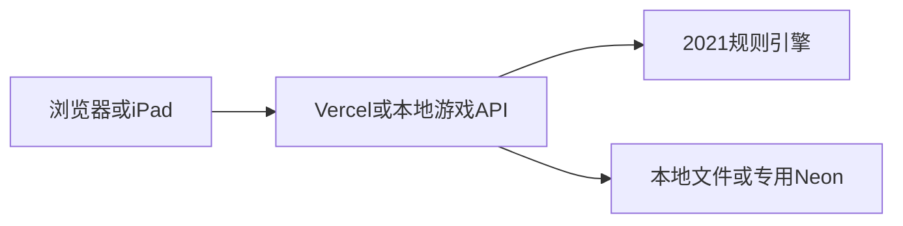

# 本地与未来公网架构

## 边界

浏览器仅显示允许看到的局面并提交意图。服务端决定随机结果、合法行动、隐藏卡、回合、奖励和计分。每次行动生成新状态，成功保存后才返回客户端。

| 文件 | 责任 |
| --- | --- |
| `lib/game.mjs` | 对局状态机、动作和效果队列、计分、玩家视图 |
| `lib/automa.mjs` | 官方基础版 Leopold 指令事实、三档图标过滤、客人/骰子/目标选择与自动行动 |
| `lib/table-session.mjs` | 可选倒计时、全员协商、限量私有撤销快照及公开控制视图 |
| `lib/catalog.mjs` | 将核验事实转换为效果数据，五酒店布局、目标和皇帝 |
| `reference/card-facts-2021.json` | 核验后的机械事实；不属于客户端静态包 |
| `lib/auth.mjs` | scrypt 密码哈希、随机会话、限流 |
| `lib/api.mjs` | 身份/房间成员校验、版本号、操作去重、请求边界 |
| `lib/store.mjs` | 本地原子替换与串行写入；Neon 参数化查询与条件更新 |
| `server.mjs` | 本地启动、环境配置、局域网地址 |
| `api/index.mjs` | 未来 Vercel 函数入口，未配置时拒绝服务 |
| `integrations/hexo.mjs` | 本地博客子路径中间件，独立文件存档，不读取博客/Waline数据库配置 |
| `public/` | 公开页面、中文控件、局面渲染、同步；无真实凭据 |
| `preview-src/` | 单人示例场景和浏览器随机数适配，复用纯规则引擎 |
| `public/preview-engine.mjs` | esbuild生成的浏览器示例包，仅含规则和公开机械事实 |

## 对局状态

多人新局：`lobby → setupStaff → setupGuest → setupRooms → turn → emperor → turn / finished`。旧存档随机发牌时直接进入 `setupGuest`；单人使用 `soloDraft` 效果。

`effects` 是待处理效果队列。需要选择的效果只允许指定玩家处理；自动收益在服务器结算。任一未处理效果会阻止无关额外动作。皇帝全部玩家的效果处理完后才换轮。

`slots` 保存该轮蛇形号码，`done` 表示实际消耗，`passed` 仅表示当前骰池暂缓。每次重掷只清除 `passed`。主动作和可选迎客分别计数。`bonuses` 记住已领取的房组，即使皇帝拆房后重新填满也不重复奖励。

## 并发与持久化

所有行动含 `version` 和随机 `requestId`。旧版本拒绝并要求刷新；近期重复请求返回当前局面，不重复执行。Neon 使用 `UPDATE ... WHERE version = expected` 条件写入；并发请求只有一个能提交。本地文件由单进程队列串行写入临时文件，再原子替换。

本地会话和存档仅存 `.private/`。房间最后行动后保留7天；玩家会话7天有效。持有导出的重连文件即可恢复该会话，文件需要像密码一样保管。

Hexo模式在同一个本地HTTP服务中挂载 `/friends-hotel/`，前端和API同源，密码初始化检查保留真实来访地址，不通过会伪装本机地址的代理。静态输出只含显式白名单中的前端文件、示例规则包和原创插画；站内搜索使用独立追加条目，不创建博客文章。博客模式独立使用 `.private/blog-state.json`，不与同时运行的4173试玩进程竞争同一存档。

## 单人画面测试与界面

单人入口先通过现有会话的`/api/me`校验；未登录会回到密码页，登录后可直接进入。普通示例由浏览器生成两个虚拟座位，“满座与全员总览”生成四席，所有动作在页面内存中执行；不会调用建房、加入或行动写接口。重置/退出不会修改现有好友对局，真实会话也不被替换成示例身份。

`scripts/build-preview.mjs`只打包`lib/game.mjs`、`lib/catalog.mjs`、公开机械事实和示例场景；构建时将Node随机数导入替换成浏览器WebCrypto适配。服务器继续使用Node crypto及服务端权威验证。认证、存储、真实房间状态与任何凭据都不进入示例包。浏览器内的纯规则源码不构成真实联机的信任边界。

`public/arrival-view.mjs`负责入口，`table-view.mjs`负责棋盘布局，`visuals.mjs`提供原创SVG图标，`style.css`负责维也纳饭店主题。两张原创PNG置于`public/assets/`，Hexo只生成显式列出的公开资源。

`display-mode.mjs`独立于游戏重绘，用户点击后尝试标准/WebKit全屏API；缺失或拒绝时进入CSS沉浸布局，保留退出按钮和Esc退出。控制器持有同一个控件节点；`app.mjs`将它放在普通页页头，`table-view.mjs`每次重绘后通过`onLayout`将原节点移入游戏页头，与设置按钮并排。`onLayout`同时传递弹窗状态，`mount`用`hidden`将控件从弹窗画面和键盘焦点序列移除；关闭弹窗后恢复原节点及全屏状态。CSS的`[hidden]`规则和遮罩存在检查作为显示约束。控件不浮动，不复制事件监听器。监听浏览器退出事件以同步按钮状态，不锁定方向或缩放，不修改对局。

博客仓库包含`apps/grand-austria-hotel/`的可移植源码。`GAH_PROJECT_DIR`优先；未设置时，本机已有开发项目继续使用原存档，CI回退仓库内项目。Pages构建只发布公开白名单，未配置`GAH_PUBLIC_API_ORIGIN`时写入`HOTEL_ONLINE_PENDING`显示待开门页。本地中间件动态配置不写此标记，继续服务端密码验证。

## 安全与博客隔离

- 统一管理员密码由部署环境保存scrypt哈希，允许进入大厅和创建房间；不设个人密码。好友可以通过`/api/room-login`提交昵称与四位数字房间码，直接加入对应房间。
- 管理员会话标记`access=admin`，邀请码会话标记`access=room`并绑定房间码与独立房间实例ID。邀请码会话不能创建房间或访问其他房间；进入后仍按真实成员、回合与房主身份校验。昵称仅用于座位显示。
- 新房间码为1000–9999，碰撞时重试。过期码可原子复用；实例ID同时参与存档更新条件，防止旧请求覆盖复用该号码的新房间。已有七位码对局保留读取与重连兼容。
- 每个座位仍有随机独立会话，数据库仅保存令牌摘要；刷新、重连使用自己的会话，不向浏览器发送管理员密码或哈希。
- 对手手牌、牌库顺序、尚未选择的秘密员工不会返回浏览器；不是仅靠界面隐藏。
- 所有用户可见文本转义，SQL 参数化，限制请求大小和操作字段。
- CORS 显式配置允许来源；它只负责浏览器来源约束，身份检查始终由会话完成。
- API 不输出数据库错误、连接字符串或服务端日志堆栈；静态服务只允许 `public/` 中指定类型文件。
- 公网游戏使用单独 Vercel/Neon 项目和受限数据库账号，API函数与数据库均位于新加坡。通过 `GAME_DATABASE_URL` 显式启用云存储，避免误用博客的通用 `DATABASE_URL`。`.vercelignore`明确排除本地存档和环境文件。
- 当前应用内限流只在单进程/单实例有效。公网发布前还要配置平台级限流；不要把本地测试通过当成已验证线上防刷。
- 相同 Vercel 团队仍可能共享额度和预算动作。独立项目能降低代码/凭据串用的风险，不承诺所有账号级资源完全隔离。

GitHub Pages 的 HTML/JS 始终是公开静态文件。服务端密码保护的是进入游戏和访问对局数据；隐藏导航与 `noindex` 只减少公开展示。

## 2026-10-17 本地交互改版

用户已要求暂停发布。本轮仅修改本地开发项目，不导出覆盖博客仓库源码，不提交或推送GitHub。

游戏改用固定视口操作台：顶部状态和骰子、中央当前区域、底部动作与五个区域按钮。客人/员工/目标等集合依据当前宽高分页，窗口不依赖上下滚动。图形选择保持规则引擎的服务端验证。

- 每个新回合先弹出迎客卡片，可点击客人画像或选择本回合先不迎客；同回合重新同步不会重复弹出。
- 完成订单后点击客人，再点击同色高亮空房，确认入住。准备房间与皇帝拆房也直接点选，前端提前筛选连接、顺序、费用与楼层。
- 食物使用加减按钮，实时限制总强度、可选类型、蛋糕/苹果卷与咖啡/酒比例。给多位客人的分配共享同一批库存，不能重复分配；厨房上菜同时限制总数3件与订单需求。
- 客人姓名及装饰标签改为中文。`public/chinese.mjs`同时供目录模块和浏览器使用；历史英文客人日志在显示时转换。
- `public/table-view.mjs`现在是有独立草稿状态的操作台控制器；`interaction-rules.mjs`保存可测试的界面约束，`tabletop.css`约束一屏布局。

参考公开资料检索到了桌思游想的官方商店页：
https://apps.apple.com/cn/app/桌思游想/id6451014013
公开页面能确认产品和奥地利大饭店的存在，未直接登录或体验App内完整流程；本次交互主要落实用户明确提出的自动迎客、图形点击和实时数量限制。

## 2026-10-18 迎客确认与视觉信息

迎客选择保存在前端`marketDraft={index,guestId}`，点击卡片只高亮。点击“确认迎接”时重新检查当前市场卡ID、回合、咖啡厅容量及费用，再提交原有动作；关闭/Esc清空草稿。市场变化会使旧选择失效。起始迎客和免费奖励也经过相同确认。所有正式规则继续由服务端校验。

`card-art.mjs`集中生成图集类名、需求勾选、所有玩家的公开分数/钱/皇冠以及目标图像。饭店上方展示当前五张公开市场客人，不展示隐藏牌库。完成订单的食物和肖像淡化并加勾。员工与客人图集只扩展表现，不改变卡牌机制。

界面将“皇帝”显示为“皇冠”，内部规则字段`emperor`与历史存档兼容；历史日志在显示时转换。固定视口结构不变，短屏房间用编号与状态图标并排呈现，详情仍可点击查看。`polish.css`处理本轮视觉改进。未来博客静态导出的公开清单已在本项目内补齐新资源；尚未导出到博客仓库。

## 2026-10-19 本地回合与全员总览

用户再次要求先不发布。本轮只更新开发项目和本地产物，不导出博客仓库、推送或部署云端。

- 满座时`shouldOfferGuest`拒绝迎客，控制器同时将本回合记为已提示，直接保留骰子操作。随后腾出座位不会在同步时自动重新弹窗；玩家仍可在规则允许时主动迎客。
- 按用户最新说明，点击咖啡厅客人打开独立窄卡片；卡片自身包含颜色、分数、满幅画像、订单、奖励、关闭及操作按钮，外部仅保留模糊游戏背景，不套用通用宽窗口。选择“安排入住”才进入酒店空房选择；“从厨房上菜”关闭卡片并使用右栏`serviceGuest/serviceCounts`草稿，复用`allocationLimit`限制库存、需求及三份总量。确认仍调用权威`serve`动作，完成后有合适空房则转为入住选择。右栏草稿在切换区域、回合变化或客人离席时清除。
- `viewGame`为公共目标返回`achievedBy`，由每位玩家的公开资源、房间和已雇员工推导，不包含隐藏手牌。`claimed`保留实际领取顺序，即使玩家后来消耗金币，已领取名次仍然存在。`card-art.mjs`展示三档名次以及所有玩家的当前达成/领取状态。
- 皇冠页排列三轮奖惩、七轮时间线及全员轨道。玩家使用固定座位编号和颜色，重叠位置中的标记逐个排列；图例显示姓名和格数。`overview`示例覆盖满座、四人同格、尚未领取和已领取后条件不再满足的情况。

## 2026-10-19 桌上工具与反悔协商（仅本地）

员工详情复用窄卡片与模糊背景结构，所有弹窗支持只点击遮罩本身关闭；卡片内部点击不会关闭窗口。关闭只影响前端草稿，不会放弃服务端待处理效果或隐式拒绝协商。

`applyAction`先经过`table-session.mjs`，普通规则动作继续交给原规则分支。旧存档没有`tableSession`时按计时关闭、无历史兼容。最多保留12个动作前快照，快照不嵌套`tableSession`；`viewGame`只使用显式的公开控制视图，绝不发送历史快照、牌库顺序或他人隐藏手牌。

- 房主可设置5–3600秒的回合时长、提醒阈值、三种颜色、自动开始和超时策略。当前行动玩家及房主可暂停、继续或重置当前计时。运行中的时钟使用服务端绝对截止时间，客户端根据`serverNow`校正显示，逐秒更新不重绘表单。
- 自动结束仅在正常行动阶段且无待处理效果时消耗当前回合，不自动取骰或选择牌。强制处理奖励/处罚后才执行超时结束；关闭计时或仅提醒时不执行自动动作。`advanceTableTime`只走内部保留动作，客户端不能伪造该动作。
- API在成员鉴权后、读取或提交动作之前检查到期时间；有变化时通过原有版本号CAS保存。并发轮询只推进一次，旧版本动作返回409。没有玩家连接时不运行后台作业；重连时处理已到期的当前回合，然后给下一回合正常时长。
- 重置骰子只能在本轮第一位玩家尚未执行任何规则动作前申请，重新生成本轮全部骰子（2/3/4人分别10/12/14枚），不恢复已消耗行动。`roundPlayStarted`及回合、骰数、号码状态共同限制窗口，跳过也算开始行动。
- 反悔只申请撤销最新的自己一步，其后有别人操作即不可申请。申请人自动同意，其余每位玩家必须逐个同意；任何一人拒绝或申请人取消则保持局面。协商期间暂停时钟并阻止规则动作，取消/拒绝后按冻结的剩余时间继续。
- 通过反悔后恢复完整的动作前局面，包括钱、分数、客人、房间、牌库和待处理效果；倒计时恢复为暂停，便于玩家继续选择。保留房主最新的计时设置，恢复的剩余时间不超过当前配置时长。申请提示明确说明已知牌面信息无法收回。房间版本号、会话和操作去重记录不随游戏快照回退。
- 单人示例复用同一套逻辑，自动跟随尚未表态的虚拟玩家，便于独立检查两人或四人协商；自动超时也仅影响页面内存。

## 2026-10-19 官方基础版单人对局（仅本地）

`newLobby`接受显式`mode=solo`和`difficulty=easy/medium/hard`，固定一名真人和一个非会话的`bot`座位；拒绝加入第三者或客户端冒用自动对手。多人旧存档不含`solo`，继续原规则。开局使用待选效果`soloDraft`处理十选六和四张归还排序，随后只有真人参与起始迎客与房间准备。

`applyAction`在原有权威动作/桌上工具成功后调用`settleSolo`，同一事务内运行连续自动回合。`advanceTableTime`在合法超时推进后复用此路径。自动行动读取私有指令牌顺序，补充市场、更新房间/皇冠/目标和日志，遇到真人回合、待选效果或终局即停止。自动行动使用克隆，不修改传入旧状态；API沿用版本CAS与请求去重，因此重复请求或并发轮询不会多走电脑回合。自动行动完成后同步持久化时钟到真实的下一位玩家。

只有自动对手忽略客人/房组奖励和皇冠奖惩；终局依照官方严格比分决定胜者，同分由自动对手获胜。员工评分继续复用现有函数：电脑房间实际状态保持`closed/occupied`，概念上的“视作已准备”只用于自动入住，不令员工34误算20间房。

`state.solo`保存隐藏指令顺序、五张私人终局员工、目标计数和最近行动。`soloView`显式输出可见字段，绝不复制隐藏数组。目标页对电脑显示III/II倒计数；已翻开的员工公开，私人剩余部分仅显示卡背数量。独立的单人房间会照常保存与恢复；示例模式继续是一人控制多个座位。

单人桌上工具内部自动通过电脑一票；撤销快照包含相应玩家动作之后的电脑行动，客户端仍看不到快照。重掷整轮骰子的窗口与多人一致，第一位开始行动后关闭。规则细节与资料核验见`SOLO.md`。

## 2026-10-19 手机适配与操作窗口（仅本地，尚未发布）

- 新增同一子路径内的 `manifest.webmanifest` 和三种尺寸的原创饭店图标，补齐 iOS 主屏幕应用元数据。支持的浏览器仍使用原生全屏；不支持时明确区分“沉浸布局”和浏览器全屏，并展示主屏幕打开说明。主屏幕模式隐藏多余的全屏按钮。`display-mode.mjs` 监听可视视口高度，保留缩放能力；迁移浏览器身份仍使用现有重连文件，不将令牌放入 URL 或 manifest。
- 房间始终预留相同的房号、状态、金币与分数区域，所有状态共用定位。尺寸切换依据实际房间容器高度；最窄屏幕将房号放在图标上方。同色墙纸与各房间分隔线保持原逻辑。
- 他人公开卡牌改为可纵向滚动的紧凑网格。手机每行两张，客人和员工共用正方形肖像窗口；员工之后追加同尺寸的卡背，只接收公开数量。详情不改变服务器隐藏信息边界。
- `interaction-rules.mjs` 新增只读的 `missingFoods`、`servingResources`、`dicePlan`、`turnEndIntent`，用于需求提示、按客人筛选、动作报价和单个结束按钮。真实食饮、费用、骰子和回合变更仍由服务端裁决。
- 选食物显示全部咖啡厅剩余需求和厨房库存；分配与上菜只显示当前客人未满足的食物，保留已选项目的减号。新获得的食物与厨房存货仍分别处理，不混用免费分配和付费上菜规则。
- 动作窗口可在确认前切换五种动作，选择6号骰复制及付费加一，统一计算费用与员工强度加成。确认前不提交对局动作；确认后沿用原来的待处理效果队列。额外骰子奖励继续禁止付费增强，并保留其复制费用规则。
- 右栏合并为一个“结束回合”按钮：尚未行动时调用原有 `pass`，主动作完成后调用 `endTurn`；迎客或其他动作后仍不能绕过必须取骰的要求。没有修改官方暂缓与重掷规则。

本轮只修改开发项目及本地构建产物，没有导出到博客仓库、提交、推送或部署。

## 2026-10-19 固定动作窗口、一次提交和员工轮抽（仅本地）

- 新多人房间的 `staffSetup` 默认为 `draft`。`staffDraft` 保存座位顺序、每人的六张私有牌包、轮数和当前玩家索引。每位选一张后交给下一位；整轮完成才向左轮转余牌，六轮后进入原起始迎客阶段。无此字段的旧存档保持随机发六张，单人仍十选六。
- `viewGame` 只向当前选牌玩家构造 `staffDraft` 提示及候选卡；其他人得到等待提示。公开 `draft.picks` 只有玩家和已选数量，日志不包含牌号。`draftStaff` 复用成员校验、当前玩家校验、版本号、持久化和请求去重。
- `die` 和额外骰子 `resolve` 可附带狭义 `choice`，包含主动作的食饮数量/免费分配、房间、钱与皇冠分配或员工选择。服务端先在克隆上完整校验，再与取骰和费用一起结算。旧客户端不传 `choice` 仍使用原效果队列。重复同一请求不会重复扣钱或收益，一次合并动作也只生成一个反悔快照。
- 主动作的预选只附在第一项主效果，不传给员工附带效果。若先执行员工选择后导致预选失效，保留原主效果并提示重新选择，防止局面卡住。自动效果仍由服务端推进，客户端无权决定额外收益。
- 五种动作使用固定大小的同一窗口，共用固定的骰子栏、开关栏、说明、咖啡厅需求/库存、支付栏与确认按钮；中间输入区独立滚动。选骰、复制、增强、数量与可选直接分配均在最终“执行行动”前编辑，关闭窗口不取骰或扣钱。
- 所有员工集合统一每行两张并纵向滚动，包括起始轮抽、单人十选六、手牌、已雇员工、雇用和弃牌。员工列表保留本地滚动位置；他人公开信息仍遵循原权限过滤。

## 2026-10-20 多个人机与公开行动流（仅本地）

- `newLobby(mode=solo,botCount=1..3)`保留一位真人、固定1–3个无会话电脑，总人数2–4。单电脑继续使用原 `solo` 私有字段；多电脑使用 `solo.opponents[playerId]` 分别保存指令、员工、进度和最近行动，旧单人存档无需迁移。`runSolo`逐个处理当前电脑，直到真人、强制选择或终局；有限循环覆盖同轮和跨轮连续电脑行动。多电脑使用独立虚拟员工副本，详见 `SOLO.md`。
- `soloView`对每位电脑显式构造公开对象，只有剩余数量、进度与已经公开的最近指令，不拷贝隐藏数组。目标与员工卡背按对应电脑读取。最高人机分为真人获胜的严格门槛；所有电脑票自动通过桌上工具的协商。
- `lib/activity.mjs`从已成功的动作及公开状态差异构造回执；电脑每次指令也写入公开步骤。`activity.serial`单调递增，按操作组保存最多96个步骤；动作失败或API去重不会产生回执，撤销只恢复棋盘，保留已经公开的信息和递增序号。回执从不拷贝原始动作、效果队列、隐藏手牌或未来指令。
- `public/action-player.mjs`是只负责展示的有界顺序队列。首次进入不自动播放历史；后续只播放新收到的他人回执，允许最近操作组回放及停止。重播不发游戏动作。`table-view.mjs`局部更新动态栏，强调对应玩家和骰子；只有查看同一玩家的公开饭店时才强调其房间。尊重减少动画设置，回放不会阻止主动操作或更改服务器时钟。
- `POST /rooms/:code/activity`只接收当前成员的当前版本和枚举状态，拒绝自定义文本、额外字段、他人/过期身份。`liveActivity`位于游戏快照外，12秒过期；`setActivity`仅在房间实例、版本匹配时更新，Neon使用局部 `jsonb_set`，不改规则版本、存档寿命或请求去重。当前版本/行动人不符时不返回状态；普通带 `since` 轮询也返回最新状态。
- 客户端只在可见、轮到本人且最近30秒有输入时心跳；更新受最小间隔和服务端限流约束。活动轮询只局部改动态栏，不重绘正在编辑的动作或计时设置。失败不影响实际行动，状态过期自动退回等待。
- 静态白名单增加 `action-player.mjs`，本轮没有导出或部署任何博客/服务器代码。前端与API更改需在未来发布时一并部署。
