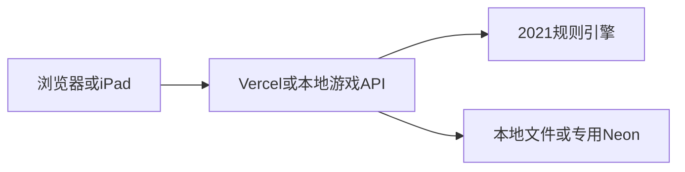

# 本地与未来公网架构

## 边界

浏览器仅显示允许看到的局面并提交意图。服务端决定随机结果、合法行动、隐藏卡、回合、奖励和计分。每次行动生成新状态，成功保存后才返回客户端。

| 文件 | 责任 |
| --- | --- |
| `lib/game.mjs` | 对局状态机、动作和效果队列、计分、玩家视图 |
| `lib/catalog.mjs` | 将核验事实转换为效果数据，五酒店布局、目标和皇帝 |
| `reference/card-facts-2021.json` | 核验后的机械事实；不属于客户端静态包 |
| `lib/auth.mjs` | scrypt 密码哈希、随机会话、限流 |
| `lib/api.mjs` | 身份/房间成员校验、版本号、操作去重、请求边界 |
| `lib/store.mjs` | 本地原子替换与串行写入；Neon 参数化查询与条件更新 |
| `server.mjs` | 本地启动、环境配置、局域网地址 |
| `api/index.mjs` | 未来 Vercel 函数入口，未配置时拒绝服务 |
| `integrations/hexo.mjs` | 本地博客子路径中间件，独立文件存档，不读取博客/Waline数据库配置 |
| `public/` | 公开页面、中文控件、局面渲染、同步；无真实凭据 |
| `preview-src/` | 单人示例场景和浏览器随机数适配，复用纯规则引擎 |
| `public/preview-engine.mjs` | esbuild生成的浏览器示例包，仅含规则和公开机械事实 |

## 对局状态

`lobby → setupGuest → setupRooms → turn → emperor → turn / finished`。

`effects` 是待处理效果队列。需要选择的效果只允许指定玩家处理；自动收益在服务器结算。任一未处理效果会阻止无关额外动作。皇帝全部玩家的效果处理完后才换轮。

`slots` 保存该轮蛇形号码，`done` 表示实际消耗，`passed` 仅表示当前骰池暂缓。每次重掷只清除 `passed`。主动作和可选迎客分别计数。`bonuses` 记住已领取的房组，即使皇帝拆房后重新填满也不重复奖励。

## 并发与持久化

所有行动含 `version` 和随机 `requestId`。旧版本拒绝并要求刷新；近期重复请求返回当前局面，不重复执行。Neon 使用 `UPDATE ... WHERE version = expected` 条件写入；并发请求只有一个能提交。本地文件由单进程队列串行写入临时文件，再原子替换。

本地会话和存档仅存 `.private/`。房间最后行动后保留7天；玩家会话7天有效。持有导出的重连文件即可恢复该会话，文件需要像密码一样保管。

Hexo模式在同一个本地HTTP服务中挂载 `/friends-hotel/`，前端和API同源，密码初始化检查保留真实来访地址，不通过会伪装本机地址的代理。静态输出只含显式白名单中的前端文件、示例规则包和原创插画；站内搜索使用独立追加条目，不创建博客文章。博客模式独立使用 `.private/blog-state.json`，不与同时运行的4173试玩进程竞争同一存档。

## 单人画面测试与界面

单人入口先通过现有会话的`/api/me`校验；未登录会回到密码页，登录后可直接进入。示例由浏览器生成两个虚拟座位，所有动作在页面内存中执行；不会调用建房、加入或行动写接口。重置/退出不会修改现有好友对局，真实会话也不被替换成示例身份。

`scripts/build-preview.mjs`只打包`lib/game.mjs`、`lib/catalog.mjs`、公开机械事实和示例场景；构建时将Node随机数导入替换成浏览器WebCrypto适配。服务器继续使用Node crypto及服务端权威验证。认证、存储、真实房间状态与任何凭据都不进入示例包。浏览器内的纯规则源码不构成真实联机的信任边界。

`public/arrival-view.mjs`负责入口，`table-view.mjs`负责棋盘布局，`visuals.mjs`提供原创SVG图标，`style.css`负责维也纳饭店主题。两张原创PNG置于`public/assets/`，Hexo只生成显式列出的公开资源。

`display-mode.mjs`独立于游戏重绘，用户点击后尝试标准/WebKit全屏API；缺失或拒绝时进入CSS沉浸布局，保留固定退出按钮和Esc退出。监听浏览器退出事件以同步按钮状态，不锁定方向或缩放，不修改对局。

博客仓库包含`apps/grand-austria-hotel/`的可移植源码。`GAH_PROJECT_DIR`优先；未设置时，本机已有开发项目继续使用原存档，CI回退仓库内项目。Pages构建只发布公开白名单，未配置`GAH_PUBLIC_API_ORIGIN`时写入`HOTEL_ONLINE_PENDING`显示待开门页。本地中间件动态配置不写此标记，继续服务端密码验证。

## 安全与博客隔离

- 使用共享访问密码进入，之后每个玩家获得随机独立会话；数据库仅保存会话摘要。
- 房间码只定位房间。读取、行动都检查实际房间成员。请求中的玩家ID不能指定操作者身份。
- 对手手牌、牌库顺序、尚未选择的秘密员工不会返回浏览器；不是仅靠界面隐藏。
- 所有用户可见文本转义，SQL 参数化，限制请求大小和操作字段。
- CORS 显式配置允许来源；它只负责浏览器来源约束，身份检查始终由会话完成。
- API 不输出数据库错误、连接字符串或服务端日志堆栈；静态服务只允许 `public/` 中指定类型文件。
- 公网游戏使用单独 Vercel/Neon 项目和受限数据库账号，API函数与数据库均位于新加坡。通过 `GAME_DATABASE_URL` 显式启用云存储，避免误用博客的通用 `DATABASE_URL`。`.vercelignore`明确排除本地存档和环境文件。
- 当前应用内限流只在单进程/单实例有效。公网发布前还要配置平台级限流；不要把本地测试通过当成已验证线上防刷。
- 相同 Vercel 团队仍可能共享额度和预算动作。独立项目能降低代码/凭据串用的风险，不承诺所有账号级资源完全隔离。

GitHub Pages 的 HTML/JS 始终是公开静态文件。服务端密码保护的是进入游戏和访问对局数据；隐藏导航与 `noindex` 只减少公开展示。

## 2026-10-17 本地交互改版

用户已要求暂停发布。本轮仅修改本地开发项目，不导出覆盖博客仓库源码，不提交或推送GitHub。

游戏改用固定视口操作台：顶部状态和骰子、中央当前区域、底部动作与五个区域按钮。客人/员工/目标等集合依据当前宽高分页，窗口不依赖上下滚动。图形选择保持规则引擎的服务端验证。

- 每个新回合先弹出迎客卡片，可点击客人画像或选择本回合先不迎客；同回合重新同步不会重复弹出。
- 完成订单后点击客人，再点击同色高亮空房，确认入住。准备房间与皇帝拆房也直接点选，前端提前筛选连接、顺序、费用与楼层。
- 食物使用加减按钮，实时限制总强度、可选类型、蛋糕/苹果卷与咖啡/酒比例。给多位客人的分配共享同一批库存，不能重复分配；厨房上菜同时限制总数3件与订单需求。
- 客人姓名及装饰标签改为中文。`public/chinese.mjs`同时供目录模块和浏览器使用；历史英文客人日志在显示时转换。
- `public/table-view.mjs`现在是有独立草稿状态的操作台控制器；`interaction-rules.mjs`保存可测试的界面约束，`tabletop.css`约束一屏布局。

参考公开资料检索到了桌思游想的官方商店页：
https://apps.apple.com/cn/app/桌思游想/id6451014013
公开页面能确认产品和奥地利大饭店的存在，未直接登录或体验App内完整流程；本次交互主要落实用户明确提出的自动迎客、图形点击和实时数量限制。

## 2026-10-18 迎客确认与视觉信息

迎客选择保存在前端`marketDraft={index,guestId}`，点击卡片只高亮。点击“确认迎接”时重新检查当前市场卡ID、回合、咖啡厅容量及费用，再提交原有动作；关闭/Esc清空草稿。市场变化会使旧选择失效。起始迎客和免费奖励也经过相同确认。所有正式规则继续由服务端校验。

`card-art.mjs`集中生成图集类名、需求勾选、所有玩家的公开分数/钱/皇冠以及目标图像。饭店上方展示当前五张公开市场客人，不展示隐藏牌库。完成订单的食物和肖像淡化并加勾。员工与客人图集只扩展表现，不改变卡牌机制。

界面将“皇帝”显示为“皇冠”，内部规则字段`emperor`与历史存档兼容；历史日志在显示时转换。固定视口结构不变，短屏房间用编号与状态图标并排呈现，详情仍可点击查看。`polish.css`处理本轮视觉改进。未来博客静态导出的公开清单已在本项目内补齐新资源；尚未导出到博客仓库。
